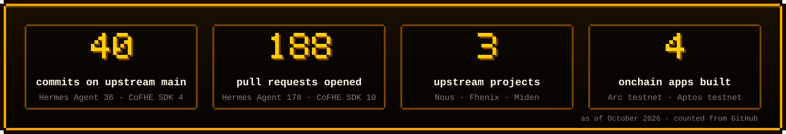
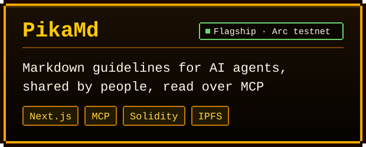
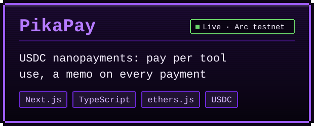
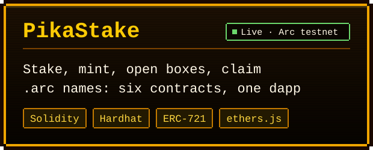
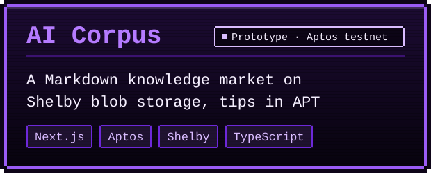

  

  
  
  
  

I read large codebases end to end, track down the bugs that hide between their parts (state leaking across profiles, races, unbounded waits, corrupted handles) and send small, focused fixes upstream. Nearly every fix ships with a regression test. On my own time I build onchain apps for AI agents and stablecoin payments.

  

## Open-source contributions

### [Hermes Agent](https://github.com/NousResearch/hermes-agent) · NousResearch

The open-source agent framework from Nous Research. Since February 2026 I've opened **178 pull requests**; **36 of my commits are on `main` under my name**: 7 merged directly and 29 cherry-picked by the maintainers into their salvage pull requests with my authorship kept. Two more gateway fixes landed with `Co-authored-by` credit.

| Area | What I fixed |
|---|---|
| **Gateway: profile isolation** | Several profiles share one gateway process, and settings kept leaking between them. I scoped the OpenAI-compatible [Idempotency-Key cache](https://github.com/NousResearch/hermes-agent/commit/2b7eb97fbf) and [folded the route and caller into the key](https://github.com/NousResearch/hermes-agent/commit/3d59486a86), the [proxy URL](https://github.com/NousResearch/hermes-agent/commit/5725efaf09), and the adapter settings for [Mattermost](https://github.com/NousResearch/hermes-agent/commit/56d869d2d9), [IRC](https://github.com/NousResearch/hermes-agent/commit/05aa749977), [ntfy](https://github.com/NousResearch/hermes-agent/commit/327e9043e9), [WeCom](https://github.com/NousResearch/hermes-agent/commit/07ee457a21), [SMS](https://github.com/NousResearch/hermes-agent/commit/8099745a4e), [A2A](https://github.com/NousResearch/hermes-agent/commit/79732c6452) and more. Co-author of the fix that stopped [secondary profiles sending their credentials to the default profile's host](https://github.com/NousResearch/hermes-agent/commit/e253ea0233). |
| **Session database integrity** | Kept corrupt or replaced SQLite handles out of [`rebuild_fts()`](https://github.com/NousResearch/hermes-agent/commit/17b2768b86), [`vacuum()` and `optimize_fts()`](https://github.com/NousResearch/hermes-agent/commit/9e0dc4319a) and the [housekeeping retry](https://github.com/NousResearch/hermes-agent/commit/c79df9c4d9); closed a [blind spot in the lock gate](https://github.com/NousResearch/hermes-agent/commit/c7429f60ca). |
| **Desktop app reliability** | Put time bounds on every `getConnection()` / `resolveGatewayWsUrl()` wait in the Electron app ([boot path](https://github.com/NousResearch/hermes-agent/commit/31f3de1f06), [every remaining route](https://github.com/NousResearch/hermes-agent/commit/d81b801fb4), [fallback](https://github.com/NousResearch/hermes-agent/commit/fbe51fa734)) and [claim-guarded backend start-up](https://github.com/NousResearch/hermes-agent/commit/1e73281614). |
| **Runtime safety** | [Reap idle remote code-execution kernels and cap them per session](https://github.com/NousResearch/hermes-agent/commit/d4126c6f49), [write profile archives atomically](https://github.com/NousResearch/hermes-agent/commit/4d4cffd118), [stop a notice from mutating a persisted tool row](https://github.com/NousResearch/hermes-agent/commit/511633be90), [end zombie Slack Socket Mode connections](https://github.com/NousResearch/hermes-agent/commit/6c1322b9), [prevent a CLI start-up crash](https://github.com/NousResearch/hermes-agent/commit/429b8ece). |

<b>All 36 commits on Hermes Agent <code>main</code></b>

| Date | Commit | Change |
|---|---|---|
| 2026-09-09 | [`17b2768`](https://github.com/NousResearch/hermes-agent/commit/17b2768b86) | fix(state): quarantine a corrupt/replaced handle out of rebuild_fts() too |
| 2026-09-09 | [`511633b`](https://github.com/NousResearch/hermes-agent/commit/511633be90) | fix(agent): stop the run-budget wrap-up notice from mutating a persisted tool row |
| 2026-09-09 | [`9e0dc43`](https://github.com/NousResearch/hermes-agent/commit/9e0dc4319a) | fix(state): guard vacuum() and optimize_fts() against quarantined SessionDB handles |
| 2026-09-07 | [`3d59486`](https://github.com/NousResearch/hermes-agent/commit/3d59486a86) | fix(gateway): fold route + authenticated principal into idempotency key |
| 2026-09-06 | [`5725efa`](https://github.com/NousResearch/hermes-agent/commit/5725efaf09) | fix(gateway): scope resolve_proxy_url()'s platform_env_var read by multiplex profile |
| 2026-09-05 | [`2b7eb97`](https://github.com/NousResearch/hermes-agent/commit/2b7eb97fbf) | fix(gateway): scope the OpenAI-compat Idempotency-Key cache by profile |
| 2026-09-02 | [`504dd1f`](https://github.com/NousResearch/hermes-agent/commit/504dd1f24f) | fix(raft): scope RAFT_PROFILE resolution to the active multiplex profile |
| 2026-09-02 | [`79732c6`](https://github.com/NousResearch/hermes-agent/commit/79732c6452) | fix(a2a): scope multiplex secondary-profile construction, not shared env |
| 2026-09-02 | [`c79df9c`](https://github.com/NousResearch/hermes-agent/commit/c79df9c4d9) | fix(state): stop the housekeeping FTS retry from running on a quarantined SessionDB |
| 2026-09-01 | [`05aa749`](https://github.com/NousResearch/hermes-agent/commit/05aa749977) | fix(irc): scope server/port/nickname/channel/use_tls reads to the active profile under multiplexing |
| 2026-09-01 | [`07ee457`](https://github.com/NousResearch/hermes-agent/commit/07ee457a21) | fix(wecom): scope WECOM_BOT_ID reads to the active profile under multiplexing |
| 2026-09-01 | [`327e904`](https://github.com/NousResearch/hermes-agent/commit/327e9043e9) | fix(ntfy): scope server/topic/publish_topic reads to the active profile under multiplexing |
| 2026-09-01 | [`56d869d`](https://github.com/NousResearch/hermes-agent/commit/56d869d2d9) | fix(mattermost): scope url/reply_mode/require_mention/free_response_channels/allowed_channels to the active profile under multiplexing |
| 2026-09-01 | [`8099745`](https://github.com/NousResearch/hermes-agent/commit/8099745a4e) | fix(sms): scope TWILIO_PHONE_NUMBER per profile |
| 2026-09-01 | [`c36def6`](https://github.com/NousResearch/hermes-agent/commit/c36def6aea) | fix(photon): scope project_id/node_bin/require_mention/reactions/sidecar config to the active profile under multiplexing |
| 2026-08-29 | [`0610291`](https://github.com/NousResearch/hermes-agent/commit/0610291b5a) | fix(prompt): sync DEFAULT_SOUL_MD with the #95681 identity rewrite |
| 2026-08-29 | [`4d4cffd`](https://github.com/NousResearch/hermes-agent/commit/4d4cffd118) | fix(profiles): make_targz writes to a temp file and renames, not the destination directly |
| 2026-08-29 | [`8142494`](https://github.com/NousResearch/hermes-agent/commit/8142494401) | fix(tui): render nested todo subtasks via the parent field |
| 2026-08-29 | [`bc81d0a`](https://github.com/NousResearch/hermes-agent/commit/bc81d0a665) | docs: sync stale /background references with the /bg + /btw split |
| 2026-08-29 | [`c7429f6`](https://github.com/NousResearch/hermes-agent/commit/c7429f60ca) | fix(state): close the SessionDB lock gate's blind spot on its own mixin files |
| 2026-08-29 | [`d6a6d87`](https://github.com/NousResearch/hermes-agent/commit/d6a6d87c4a) | fix(tools): restore setup_mcp's never-hand-edit instruction |
| 2026-08-28 | [`d4126c6`](https://github.com/NousResearch/hermes-agent/commit/d4126c6f49) | fix(code-execution): reap idle and cap remote session kernels |
| 2026-08-27 | [`d6ace97`](https://github.com/NousResearch/hermes-agent/commit/d6ace971d4) | docs(computer-use): remove the deleted typed browser-page route |
| 2026-08-26 | [`08b4875`](https://github.com/NousResearch/hermes-agent/commit/08b4875f4a) | fix(deadline): remove the dead second SuspectableBackend class shadowing the Phase 3a Protocol |
| 2026-08-26 | [`1e73281`](https://github.com/NousResearch/hermes-agent/commit/1e73281614) | fix(desktop): claim-guard every remaining ensureRegistryBackend()/ensureBackend() call in Electron main |
| 2026-08-26 | [`d81b801`](https://github.com/NousResearch/hermes-agent/commit/d81b801fb4) | fix(desktop): bound getConnection()/resolveGatewayWsUrl() on every remaining route |
| 2026-08-26 | [`fbe51fa`](https://github.com/NousResearch/hermes-agent/commit/fbe51fa734) | fix(desktop): bound the onActiveConnectionInvalidated fallback getConnection() call |
| 2026-08-25 | [`31f3de1`](https://github.com/NousResearch/hermes-agent/commit/31f3de1f06) | fix(desktop): bound getConnection() on the boot and soft-switch paths (#93454) |
| 2026-05-14 | [`4b6d35b`](https://github.com/NousResearch/hermes-agent/commit/4b6d35bed2) | fix(telegram): escape send_slash_confirm preview with format_message |
| 2026-05-04 | [`429b8ec`](https://github.com/NousResearch/hermes-agent/commit/429b8ece) | fix(cli): guard c-S-c key binding with try/except to prevent startup crash (#19895) |
| 2026-05-03 | [`808fee1`](https://github.com/NousResearch/hermes-agent/commit/808fee15) | fix(auxiliary): propagate explicit_api_key to _try_anthropic() |
| 2026-05-03 | [`9faaa29`](https://github.com/NousResearch/hermes-agent/commit/9faaa292) | fix(delegate): inherit parent fallback_chain in _build_child_agent |
| 2026-05-03 | [`e89376d`](https://github.com/NousResearch/hermes-agent/commit/e89376d6) | fix(setup): add missing SLACK_HOME_CHANNEL prompt to _setup_slack() |
| 2026-05-02 | [`6c1322b`](https://github.com/NousResearch/hermes-agent/commit/6c1322b9) | fix(slack): close previous handler in connect() to prevent zombie Socket Mode connections |
| 2026-04-25 | [`e2211b2`](https://github.com/NousResearch/hermes-agent/commit/e2211b26) | fix(compressor): reset _summary_failure_cooldown_until in on_session_reset() |
| 2026-04-24 | [`4e2b20b`](https://github.com/NousResearch/hermes-agent/commit/4e2b20b7) | fix(cli): sync use_gateway in _reconfigure_provider for tts, browser, and web |

### [CoFHE SDK](https://github.com/FhenixProtocol/cofhesdk) · Fhenix

Tooling for fully homomorphic encryption (FHE) on EVM chains. **10 pull requests, 4 merged**, the rest under review. Most of the work makes the local mocks behave exactly like the real network, so tests catch what production would.

- [#413](https://github.com/FhenixProtocol/cofhesdk/pull/413) Mock contracts reject an inverted security-zone range, like the TaskManager
- [#414](https://github.com/FhenixProtocol/cofhesdk/pull/414) Mock contracts match the TaskManager's batch decrypt-result functions
- [#415](https://github.com/FhenixProtocol/cofhesdk/pull/415) React hooks keep their `enabled` gate when `queryOptions.enabled` is set
- [#416](https://github.com/FhenixProtocol/cofhesdk/pull/416) React README encryption examples updated to the current API
- In review: [MockTaskManager emits the TaskManager's events](https://github.com/FhenixProtocol/cofhesdk/pull/430), [mock decrypts fail with the threshold network's error codes](https://github.com/FhenixProtocol/cofhesdk/pull/437), [`defaultACPExpiration` applied to client-created ACPs](https://github.com/FhenixProtocol/cofhesdk/pull/417), [Hardhat 3 plugin builds the mock contracts](https://github.com/FhenixProtocol/cofhesdk/pull/439)

### [Miden VM](https://github.com/0xMiden/miden-vm) · 0xMiden

A STARK-based zero-knowledge virtual machine in Rust. Reported two panics in `build_trace` on malformed execution witnesses: [#4042](https://github.com/0xMiden/miden-vm/issues/4042) (inconsistent AEAD stream replay lane) and [#4044](https://github.com/0xMiden/miden-vm/issues/4044) (empty or too-short replayed Merkle path).

## Projects

<table>
  <tr>
    <td width="50%" valign="top">
      
      
An agent asks for a guideline in plain words and reads it over MCP; authors publish from their own wallet, the file goes to IPFS and its hash to two verified contracts on Arc, and readers can tip in USDC with 100% going to the author. 129 unit and schema tests. <a href="https://github.com/nftpoetrist/pikamd"><b>Code</b></a>

    </td>
    <td width="50%" valign="top">
      
      
Pay-per-use tools paid in USDC from a connected wallet, with auto-pay sessions and on-chain receipts decoded from each payment's memo. <a href="https://pikapay.vercel.app"><b>Live</b></a> · <a href="https://github.com/nftpoetrist/PikaPay"><b>Code</b></a>

    </td>
  </tr>
  <tr>
    <td width="50%" valign="top">
      
      
Staking, NFT minting, loot boxes, user-created NFTs and a <code>.arc</code> name service, each its own Solidity contract. <a href="https://pikastake-nine.vercel.app"><b>Live</b></a> · <a href="https://github.com/nftpoetrist/PikaStake"><b>Code</b></a>

    </td>
    <td width="50%" valign="top">
      
      
The first take on a Markdown library for AI, on Shelby blob storage and Aptos; PikaMd grew out of it. <a href="https://github.com/nftpoetrist/ai-corpus"><b>Code</b></a>

    </td>
  </tr>
</table>

## Toolbox

  
  
  
  
   
  
  
  
  
   
  
  
  
  
  
   
  
  
  
  

## How I work

- **Read the source, not the guess.** Library behaviour comes from the installed code and the official docs, then gets written down.
- **Fix the class, not the instance.** When one call site is wrong I check its siblings; many of my Hermes fixes are sweeps across every adapter or route with the same flaw.
- **Prove it.** A fix comes with the test that fails without it.
- **Small, reviewable pull requests**, one concern each, with a clear write-up of the cause.

Numbers counted from GitHub in October 2026. Banner, stats and cards are pixel art drawn in code.

